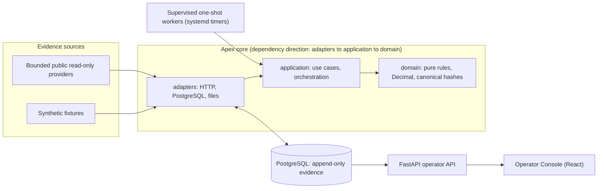
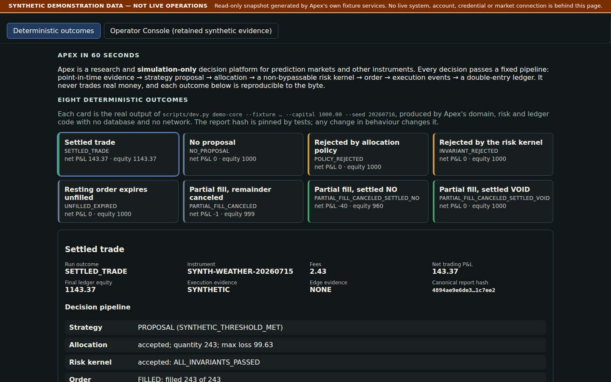
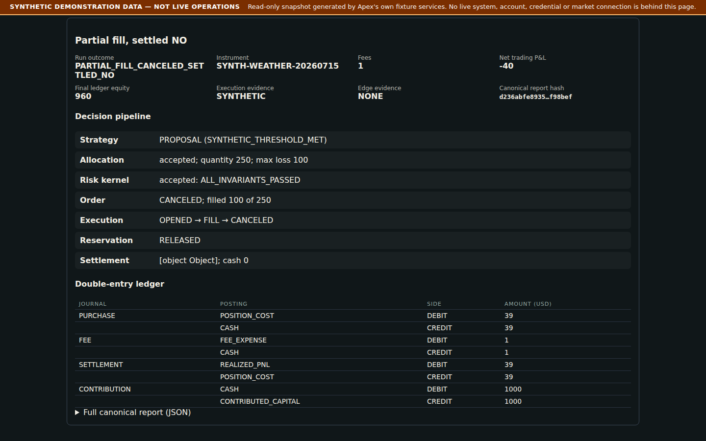
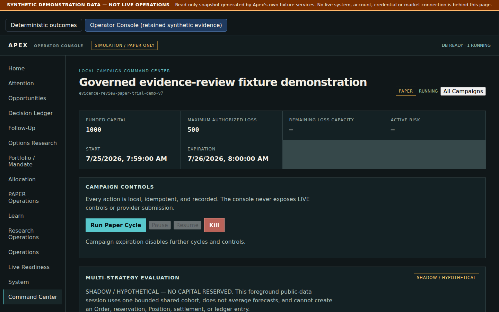
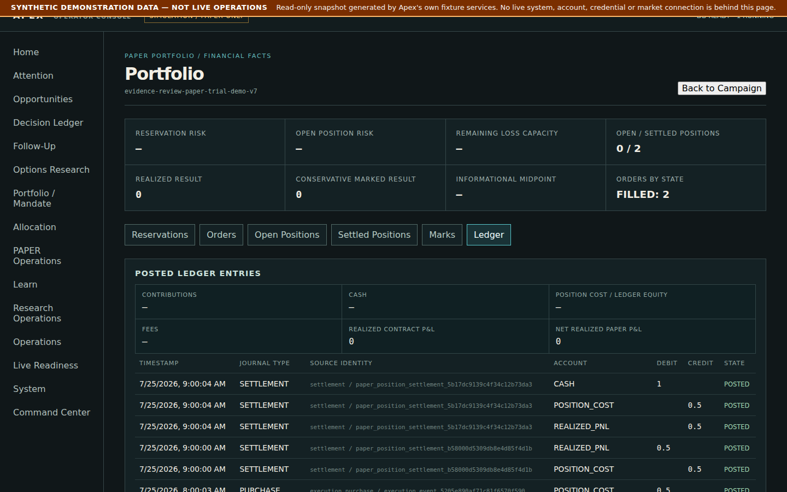
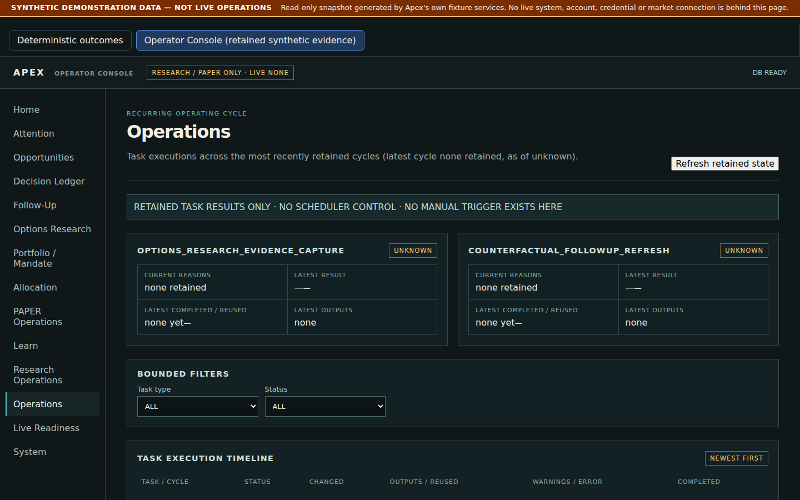

# Apex

Apex is a Python/PostgreSQL research and paper-trading **simulation** platform
built around one idea: observation may be broad, but execution authority stays
narrow, explicit, and separately governed. It captures market evidence,
stores it in append-only content-addressed tables, evaluates hypotheses and
strategies against that evidence under point-in-time rules, and keeps an
exact, replayable record of every accepted *and rejected* decision. It runs
unattended as bounded, idempotent one-shot workers and refuses to start when
the database schema does not match the code.

> **Honest scope.** Apex is **engineering evidence only**. It makes no claim
> of trading edge, profitability, calibration, or readiness for live trading.
> The financial runtime is always non-LIVE: there is no code path that places
> a real-money order. All bundled fixtures are synthetic. See
> [docs/SAFETY_MODEL.md](docs/SAFETY_MODEL.md) and
> [docs/LIMITATIONS_AND_FUTURE_WORK.md](docs/LIMITATIONS_AND_FUTURE_WORK.md).

## Try it

- **Hosted demo (static, read-only, synthetic data):** <https://zkelder.dev/apex/demo/> (case study: <https://zkelder.dev/apex/>)
- **Locally, no database or network needed:** the eight deterministic
  fixture outcomes (see [Quick start](#quick-start)).
- **Locally, full stack:** PostgreSQL via Docker Compose, then the Operator
  Console (React/Vite) over a FastAPI operator API.

## Highlights

| Area | What is in the repository |
|---|---|
| Typed Python 3.12 | `mypy --strict` over `src` and `scripts/dev.py`, `ruff` lint/format, enforced by `python scripts/dev.py typecheck` / `lint` (`pyproject.toml`). |
| PostgreSQL integrity | Reversible Alembic migrations (`migrations/versions/`); evidence tables are append-only, enforced by database triggers (`immutable_trigger_ddl` in `src/apex/adapters/postgres.py`) and tested at the database boundary (`tests/persistence/test_postgres_security.py`). |
| Docker Compose | One `postgres:17-alpine` service with healthcheck and resource limits (`compose.yaml`); per-worktree isolated project, port and test database for verification ([docs/TESTING_AND_REPRODUCIBILITY.md](docs/TESTING_AND_REPRODUCIBILITY.md)). |
| Unattended operation | systemd user timers launch bounded `--once` workers; scheduling and due-work logic live in the application, not the host (`deploy/`). A schema-compatibility guard makes workers fail closed on a revision mismatch (`src/apex/domain/schema_compatibility.py`). |
| Fault tolerance | Lease/heartbeat runner, deterministic idempotency keys, crash-resumable cycles, per-task failure isolation with dependency propagation ([docs/OPERATIONS_AND_RELIABILITY.md](docs/OPERATIONS_AND_RELIABILITY.md)). |
| Exact money | `Decimal` only; floats, NaN, exponents rejected at parse (`parse_decimal` in `src/apex/domain/values.py`); a double-entry ledger is the sole financial authority (`src/apex/domain/ledger.py`). |
| Controlled authority | Records carry `authority = "NONE"`; a tiered model (SHADOW, INTERNAL PAPER, EXTERNAL PAPER, LIVE prohibited) is enforced by tests (`tests/security/`). |
| Reproducibility | Canonical JSON + SHA-256 content hashes (`canonical_json_bytes`, `content_digest`), deterministic fixtures with registered IDs, byte-identical repeat reports under a socket-denied test run. |

## Architecture



Details and more diagrams: [docs/ARCHITECTURE_OVERVIEW.md](docs/ARCHITECTURE_OVERVIEW.md).

## Quick start

Prerequisites: Python 3.12, [`uv`](https://docs.astral.sh/uv/), and (only for
the persistence suite) Docker with Compose.

```bash
uv sync --all-extras          # or: python scripts/dev.py bootstrap
```

Run one of the eight offline, deterministic prediction-market outcomes. Each
prints a canonical JSON report; repeated runs are byte-identical.

```bash
uv run python scripts/dev.py demo-core --fixture golden --capital 1000.00 --seed 20260716
```

The registered fixture IDs (`REGISTERED_FIXTURE_IDS`, asserted in
`tests/security/test_no_live_path.py`) are: `golden`, `no-proposal`,
`policy-rejected`, `invariant-rejected`, `unfilled-expired`,
`partial-fill-canceled`, `partial-fill-canceled-settled-no`,
`partial-fill-canceled-settled-void`.

Verify (formatting/lint, `mypy --strict`, and the full offline suite with
outbound sockets denied):

```bash
uv run python scripts/dev.py verify-core
```

Optional persistence verification (isolated Docker PostgreSQL, migrations to
head, real-database tests):

```bash
uv run python scripts/dev.py db-up
uv run python scripts/dev.py verify-persistence
uv run python scripts/dev.py db-down
```

Operator Console (needs a database; see the hosted demo for a no-setup view):
`operator-build`, `operator-api` and `operator-ui` are defined in `scripts/dev.py`. The
older `operator-demo-seed`, `operator-console-demo` and `paper-portfolio-demo` seeding commands
are **stale** and currently fail (they predate the PAPER trial authorization requirement); the
supported way to produce console data is `scripts/demo/regenerate_demo_data.sh` below.

### Static synthetic demo (no backend, no credentials)

```bash
cd frontend
npm ci
npm test                      # component and demo-mode tests
npm run build:demo            # -> frontend/dist-demo
python3 -m http.server 4173 --directory dist-demo   # open http://127.0.0.1:4173/
```

The demo has two parts, both labelled by a permanent
`SYNTHETIC DEMONSTRATION DATA — NOT LIVE OPERATIONS` banner:

- **Deterministic outcomes**: the eight fixture outcomes, produced by the real
  offline `demo-core` command, shown as a decision pipeline and double-entry ledger with their
  canonical report hashes.
- **Operator Console**: the real React console reading a retained snapshot of the real operator API,
  captured from a throwaway database seeded only by Apex's fixture-only governed PAPER demo.
  Every mutation is blocked in the client; the page makes no `/api` calls.
  It opens on the populated Campaign command center; views such as Home, Opportunities and Live
  Readiness are genuinely empty in this fixture-seeded snapshot and the page says so.

Regenerate the data from scratch (isolated Docker Postgres with its own Compose project and port,
removed afterwards; two consecutive runs produce byte-identical files):

```bash
scripts/demo/regenerate_demo_data.sh              # outcomes + console snapshot
scripts/demo/regenerate_demo_data.sh --outcomes-only   # no Docker needed
```

Wall-clock fields in the snapshot (`created_at`, `recorded_at`, `timestamp`, `as_of`,
`last_activity` and a few run identifiers) are pinned to the fixture clock so the snapshot is
reproducible; every other value is verbatim API output. Several console pages honestly show
empty states, because a fixture database has no recurring-cycle history.

## Repository map

| Path | Contents |
|---|---|
| `src/apex/domain` | Pure rules: decisions, risk kernel, ledger, values, authority/readiness models. Standard library and other domain modules only. |
| `src/apex/application` | Use cases and orchestration (operating cycle, reliability, research services). No adapter imports. |
| `src/apex/adapters` | PostgreSQL repositories, bounded HTTP clients, file and fixture readers, backup drill. |
| `src/apex/operator_api.py`, `src/apex/cli.py` | FastAPI operator API (predominantly GET projections of retained evidence, plus POST routes) and the `apex` command line. |
| `migrations/` | Alembic revisions; each new evidence family adds immutable tables and a retained-evidence downgrade guard. |
| `fixtures/` | Synthetic, hash-bound inputs for the eight outcomes and a few research fixtures. |
| `frontend/` | Operator Console: React, TypeScript, Vite, Vitest. |
| `deploy/` | Example systemd user units and timers. |
| `tests/` | `security/` (boundaries), `property/` (Hypothesis), `integration/`, `persistence/` (real PostgreSQL), plus unit tests at the top level. |
| `scripts/dev.py` | The single development command runner. |
| `docs/` | Architecture, decisions, operations, safety, testing, limitations. |

## Testing and validation

Verification is tiered: narrow tests while developing; at completion the
sequence `format`, `lint`, `typecheck`, `verify-core`, `db-up`,
`verify-persistence`, `db-down`, `git diff --check`. Financial-invariant,
ledger-balance, idempotency, rollback and risk-conservation tests are never
weakened. Details: [docs/TESTING_AND_REPRODUCIBILITY.md](docs/TESTING_AND_REPRODUCIBILITY.md).

Latest recorded run for this release: Recorded 2026-10-14 on a clean checkout: `ruff` format/lint and `mypy --strict` clean; `verify-core` **3675 passed**; `verify-persistence` **946 passed, 5 skipped, 0 failed** against an isolated PostgreSQL 17 container migrated from empty to head (`0118`); frontend typecheck clean, **98 Vitest tests passed**, `npm audit` reports 0 vulnerabilities. The five skips are acceptance tests that report themselves skipped when no retained real market-data history exists in the database, which is the case for a fresh isolated database. These are results from this repository's own commands, not a claim of trading performance.

## Screenshots

All screenshots are of the static synthetic demo; the banner is part of the product, not an overlay.

| Deterministic outcomes | Outcome detail: double-entry ledger |
|---|---|
|  |  |

| Campaign command center | Posted ledger entries |
|---|---|
|  |  |



## Dependency licensing note

Apex's own code is Apache-2.0 (see `LICENSE` and `NOTICE`).

**`vectorbt` (1.1.0) is licensed "Apache 2.0 with Commons Clause"**, which is a source-available
licence and **not** an OSI-approved open-source licence. The Commons Clause withholds the right to
*Sell* the software, meaning to provide a third party, for a fee, a product or service whose value
derives entirely or substantially from vectorbt's functionality (hosting and consulting included).
How it is used here:

- It is declared as a regular pinned dependency in `pyproject.toml` and installed from PyPI by
  `uv sync`; its code is not copied into or redistributed by this repository.
- It is used only by one cross-check simulator (`src/apex/adapters/securities_baseline_simulators.py`).
  The import is guarded: if vectorbt is absent, that simulator reports itself unavailable and the
  rest of Apex, including `demo-core`, the static demo and the test suite's other paths, is unaffected.
- Apex is not offered as a paid product or service. Anyone who forks Apex to sell a product or
  service must review the Commons Clause themselves, and may need to remove the dependency.
  This note is not legal advice.

`psycopg` is LGPL-3.0 and is used as an unmodified library. The full generated dependency
inventory is in `THIRD_PARTY_LICENSES.md`.

## Limitations

Single-machine, single-operator design; fixture-scale demo data; public
read-only provider evidence only; no performance claims. Full list in
[docs/LIMITATIONS_AND_FUTURE_WORK.md](docs/LIMITATIONS_AND_FUTURE_WORK.md).

## More documentation

[Portfolio overview](docs/PORTFOLIO_OVERVIEW.md) ·
[Architecture](docs/ARCHITECTURE_OVERVIEW.md) ·
[Engineering decisions](docs/ENGINEERING_DECISIONS.md) ·
[Operations and reliability](docs/OPERATIONS_AND_RELIABILITY.md) ·
[Safety model](docs/SAFETY_MODEL.md) ·
[Testing and reproducibility](docs/TESTING_AND_REPRODUCIBILITY.md) ·
[Engineering principles](ENGINEERING_PRINCIPLES.md)

## License

Apache-2.0. See `LICENSE` and `NOTICE`.
