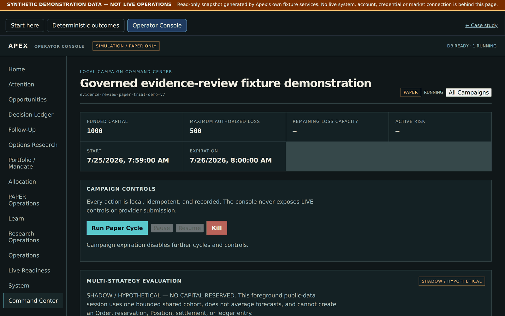
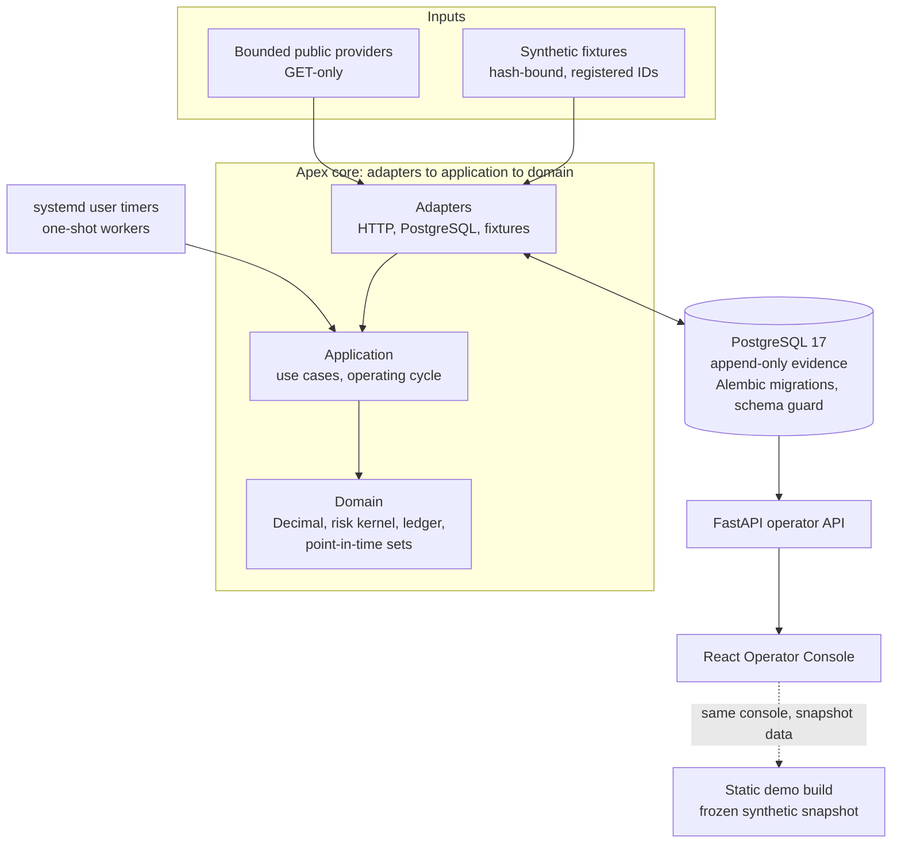
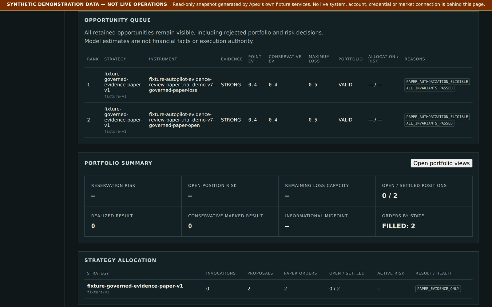
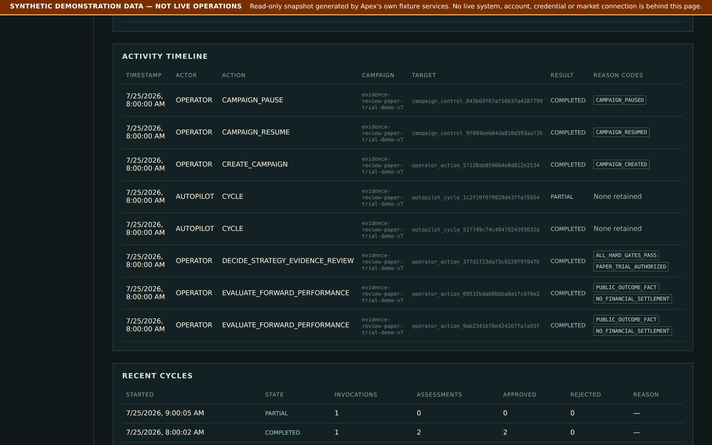
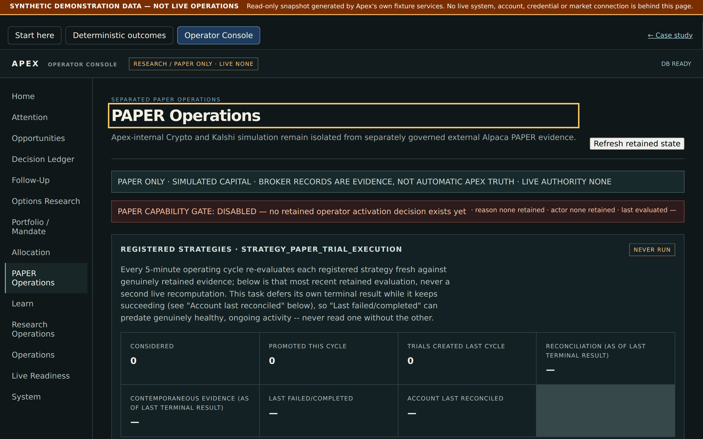
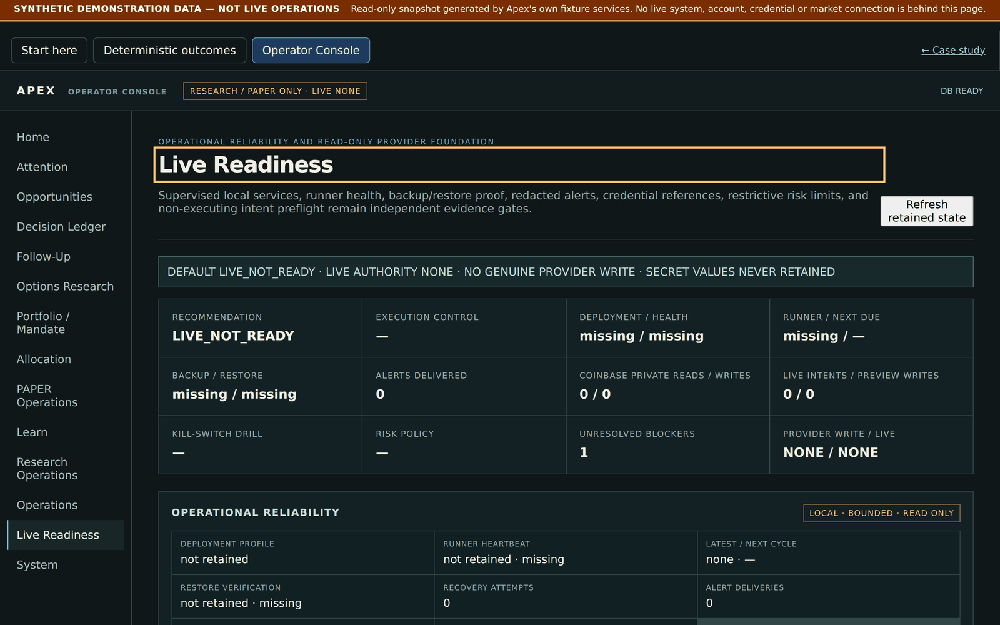
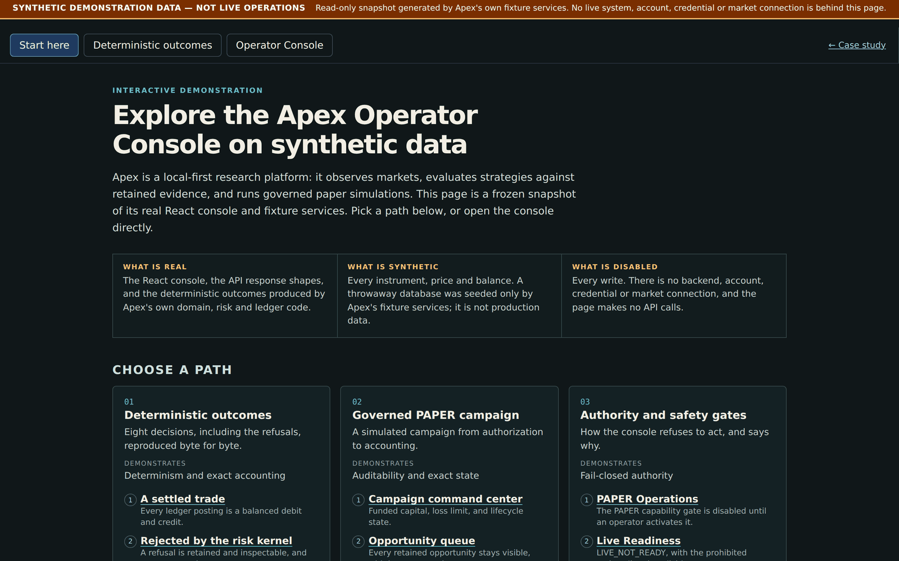

# Apex

**A local-first quantitative research platform in Python and PostgreSQL.** Apex
observes public market data, evaluates strategies against retained evidence
under point-in-time rules, runs governed paper (simulated) campaigns with exact
double-entry accounting, and operates unattended as idempotent one-shot workers
under systemd. A React Operator Console and a FastAPI service expose everything
it retains, including every rejected decision.

<p align="center">
  <a href="https://zkelder.dev/apex/demo/">
    
  </a>
  <br>
  <sub>The Operator Console, captured from the static demo. All data is synthetic and every page is labelled as such.</sub>
</p>

**[Interactive demo](https://zkelder.dev/apex/demo/)** (static, read-only, synthetic data) ·
**[Case study](https://zkelder.dev/apex/)** (architecture, engineering decisions, evidence) ·
**[Architecture](docs/ARCHITECTURE_OVERVIEW.md)** ·
**[Engineering decisions](docs/ENGINEERING_DECISIONS.md)**

> **Scope.** Apex is **engineering evidence, not a trading product.** It makes no
> claim of trading edge, profitability, calibration, or readiness for live
> trading. The financial runtime is always non-LIVE: there is no code path that
> places a real-money order, and tests enforce that. All bundled fixtures are
> synthetic. See [docs/SAFETY_MODEL.md](docs/SAFETY_MODEL.md) and
> [docs/LIMITATIONS_AND_FUTURE_WORK.md](docs/LIMITATIONS_AND_FUTURE_WORK.md).

## What Apex does

| | Job | What it means in practice |
|---|---|---|
| **Observe** | Capture evidence within strict bounds | Bounded, GET-only collectors read public Coinbase and Kalshi market data and SEC and Nasdaq reference data. Raw responses are retained with content hashes and resumable checkpoints. Missing or stale data is recorded as such. |
| **Research** | Evaluate strategies without fooling yourself | Point-in-time information sets prevent look-ahead; every experiment attempt is retained; strategy definitions carry version provenance; rejected opportunities go to a counterfactual ledger; null-control batteries measure how often noise looks like signal. |
| **Simulate** | Paper trading with exact accounting | Governed PAPER campaigns pass a risk kernel, reservations, orders, fills and balanced double-entry journals in `Decimal`, with reconciliation across fills, positions and ledger. |
| **Operate** | Run unattended, recover cleanly | A systemd timer launches a bounded worker every five minutes. It takes a lease, resumes interrupted cycles, refuses to run against a mismatched schema, and raises local alerts. |

Experimental or not exercised in the public demo: automated candidate
generation and the external-broker PAPER tiers. Not part of Apex: live trading,
real-money accounts, multi-user access and horizontal scaling.

## Engineering highlights

Each item names the code and the tests that demonstrate it.

- **Evidence is immutable in the database, not by convention.** Row-level triggers on every evidence family, `authority = 'NONE'` CHECK constraints, and downgrades that refuse to destroy retained rows
  ([`immutable_trigger_ddl`](src/apex/adapters/postgres.py), [`test_postgres_security.py`](tests/persistence/test_postgres_security.py)).
- **Workers fail closed on schema drift.** An exact required-revision guard turns a code-before-migration deploy into an explicit refusal instead of a crash loop
  ([`schema_compatibility.py`](src/apex/domain/schema_compatibility.py), [`test_schema_compatibility.py`](tests/test_schema_compatibility.py)).
- **Unattended work is idempotent and crash-resumable.** Content-addressed identities, per-task failure isolation, and a resume step that reconciles a retained cycle with current reality
  ([`operating_cycle.py`](src/apex/application/operating_cycle.py), [`test_postgres_operating_cycle.py`](tests/persistence/test_postgres_operating_cycle.py)).
- **Money is exact.** `Decimal` only, with floats, NaN and exponents rejected at parse; a double-entry ledger is the sole financial authority. A ledger defect found at the first paper-trial close (a fee counted twice) was fixed with a guarded, append-only correction
  ([`ledger.py`](src/apex/domain/ledger.py), [`test_crypto_paper_ledger_close_accounting.py`](tests/test_crypto_paper_ledger_close_accounting.py)).
- **Research output is reproducible.** Canonical JSON plus SHA-256 identities, hash-bound fixtures loaded only by registered ID, and a total-order tie-break that fixed a nondeterministic research panel
  ([`corporate_fundamentals.py`](src/apex/domain/corporate_fundamentals.py), [`test_no_live_path.py`](tests/security/test_no_live_path.py)).
- **Verification is isolated from the live system.** A deterministic per-checkout Compose project, port and test database stop one checkout's tests from touching another's data
  ([`scripts/dev.py`](scripts/dev.py), [ADR 10](docs/ENGINEERING_DECISIONS.md)).

Ten decision records with context, tradeoffs and evidence are in
[docs/ENGINEERING_DECISIONS.md](docs/ENGINEERING_DECISIONS.md).

## Architecture



The core has four subsystems, Observe, Research, Simulate and Account, all
writing to the same evidence store. More diagrams and the dependency rules:
[docs/ARCHITECTURE_OVERVIEW.md](docs/ARCHITECTURE_OVERVIEW.md).

## Quick start

Prerequisites: Python 3.12, [`uv`](https://docs.astral.sh/uv/), Node.js (current
LTS, for the demo), and (only for the persistence suite) Docker with Compose.

**1. Thirty seconds, no database and no network.** Run one of the eight
deterministic prediction-market outcomes. It prints a canonical JSON report;
repeated runs are byte-identical.

```bash
uv sync --all-extras          # or: python scripts/dev.py bootstrap
uv run python scripts/dev.py demo-core --fixture golden --capital 1000.00 --seed 20260716
```

The registered fixture IDs (`REGISTERED_FIXTURE_IDS`, asserted in
`tests/security/test_no_live_path.py`) are `golden`, `no-proposal`,
`policy-rejected`, `invariant-rejected`, `unfilled-expired`,
`partial-fill-canceled`, `partial-fill-canceled-settled-no` and
`partial-fill-canceled-settled-void`.

**2. Five minutes: the static demo, locally.**

```bash
cd frontend
npm ci
npm test                      # component and demo-mode tests
npm run build:demo            # -> frontend/dist-demo
python3 -m http.server 4173 --directory dist-demo   # open http://127.0.0.1:4173/
```

**3. Full verification.** Formatting and lint, `mypy --strict`, and the full
offline suite with outbound sockets denied:

```bash
uv run python scripts/dev.py verify-core
```

Then the real-PostgreSQL suite (isolated Docker PostgreSQL, migrated to head):

```bash
uv run python scripts/dev.py db-up
uv run python scripts/dev.py verify-persistence
uv run python scripts/dev.py db-down
```

The Operator Console needs a database: `operator-build`, `operator-api` and
`operator-ui` are defined in `scripts/dev.py`. The older `operator-demo-seed`,
`operator-console-demo` and `paper-portfolio-demo` seeding commands are
**stale** and currently fail (they predate the PAPER trial authorization
requirement); the supported way to produce console data is
`scripts/demo/regenerate_demo_data.sh`.

### The static demo

[The hosted demo](https://zkelder.dev/apex/demo/) opens on a short guide with
three paths (deterministic outcomes, a governed PAPER campaign, authority and
safety gates). Every page carries a permanent
`SYNTHETIC DEMONSTRATION DATA — NOT LIVE OPERATIONS` banner.

- **Deterministic outcomes:** the eight fixture outcomes, produced by the real offline `demo-core` command, shown as a decision pipeline and double-entry ledger with their canonical report hashes.
- **Operator Console:** the real React console reading a retained snapshot of the real operator API, captured from a throwaway database seeded only by Apex's fixture-only governed PAPER demo. Every mutation is blocked in the client and the page makes no `/api` calls. Views such as Home, Opportunities and Live Readiness are genuinely empty in this fixture-seeded snapshot and say so.

Regenerate the data from scratch (isolated Docker Postgres with its own Compose
project and port, removed afterwards; two consecutive runs produce
byte-identical files):

```bash
scripts/demo/regenerate_demo_data.sh              # outcomes + console snapshot
scripts/demo/regenerate_demo_data.sh --outcomes-only   # no Docker needed
```

Wall-clock fields in the snapshot (`created_at`, `recorded_at`, `timestamp`,
`as_of`, `last_activity` and a few run identifiers) are pinned to the fixture
clock so the snapshot is reproducible; every other value is verbatim API output.

## Screenshots

All screenshots are of the static synthetic demo. The banner is part of the product, not an overlay.

| Deterministic outcomes | Double-entry ledger for a settled trade |
|---|---|
|  |  |

| Opportunity queue | Activity timeline |
|---|---|
|  |  |

| PAPER operations: capability gate | Live readiness: fail-closed by default |
|---|---|
|  |  |



## How the pieces relate

| Artifact | What it is | Where |
|---|---|---|
| **Private operational Apex** | The running system: its history, retained data and infrastructure. It is not published. | Private |
| **This repository** | A curated, deterministic source snapshot exported from the private repository by an allow-list manifest, then scanned for secrets and operational specifics. Provenance is in `SHOWCASE_MANIFEST.json`. | [github.com/zkelder/apex-showcase](https://github.com/zkelder/apex-showcase) |
| **Hosted demo** | A static build of this repository's console over a frozen snapshot of synthetic data. No backend, database or credentials. | [zkelder.dev/apex/demo](https://zkelder.dev/apex/demo/) |

## Repository map

| Path | Contents |
|---|---|
| `src/apex/domain` | Pure rules: decisions, risk kernel, ledger, values, authority/readiness models. Standard library and other domain modules only. |
| `src/apex/application` | Use cases and orchestration (operating cycle, reliability, research services). No adapter imports. |
| `src/apex/adapters` | PostgreSQL repositories, bounded HTTP clients, file and fixture readers, backup drill. |
| `src/apex/operator_api.py`, `src/apex/cli.py` | FastAPI operator API (predominantly GET projections of retained evidence, plus POST routes) and the `apex` command line. |
| `migrations/` | Alembic revisions; each new evidence family adds immutable tables and a retained-evidence downgrade guard. |
| `fixtures/` | Synthetic, hash-bound inputs for the eight outcomes and a few research fixtures. |
| `frontend/` | Operator Console: React, TypeScript, Vite, Vitest. |
| `deploy/` | Example systemd user units and timers. |
| `tests/` | `security/` (boundaries), `property/` (Hypothesis), `integration/`, `persistence/` (real PostgreSQL), plus unit tests at the top level. |
| `scripts/dev.py` | The single development command runner. |
| `docs/` | Architecture, decisions, operations, safety, testing, limitations. |

## Reproducibility and tests

Verification is tiered: narrow tests while developing; at completion the
sequence `format`, `lint`, `typecheck`, `verify-core`, `db-up`,
`verify-persistence`, `db-down`, `git diff --check`. Financial-invariant,
ledger-balance, idempotency, rollback and risk-conservation tests are never
weakened. Details: [docs/TESTING_AND_REPRODUCIBILITY.md](docs/TESTING_AND_REPRODUCIBILITY.md).

| Check | Result | What it establishes |
|---|---|---|
| `verify-core` | **3,675 passed** | `ruff` format and lint and `mypy --strict` clean; offline tests with outbound sockets denied: financial invariants, idempotency, determinism, architecture and safety boundaries. |
| `verify-persistence` | **946 passed, 5 skipped** | Real PostgreSQL 17 migrated from empty to head (`0118`): triggers, lock ordering, concurrency, crash recovery, schema guard. The five skips are acceptance tests that need retained real market-data history, which a fresh database lacks. |
| Frontend | **101 Vitest tests passed** | Component behavior, demo read-only guarantees, guided navigation, responsive layout. `npm audit` reports 0 vulnerabilities. |

Recorded 2026-10-14 on a clean checkout. The two backend figures come from the
release commit before the demo-entry work; the backend was not changed
afterwards (`git diff` over `src`, `tests` and `migrations` is empty), and the
frontend count grew from 98 to 99 (a mobile-overflow fix) to 101 (guided entry).
Counts are pytest and Vitest results, so parametrized and property-based cases
are counted individually and are not independent scenarios. These are results
from this repository's own commands. They show correctness, reproducibility and
safe failure, not trading performance.

## Technical decisions and tradeoffs

| Decision | Why | Cost accepted |
|---|---|---|
| `Decimal` everywhere ([ADR 1](docs/ENGINEERING_DECISIONS.md)) | Floats cannot represent prices and fees exactly; drift breaks ledger balance. | More verbose; slower numeric research; explicit parsing at every boundary. |
| Append-only evidence enforced by triggers ([ADR 2](docs/ENGINEERING_DECISIONS.md)) | Application bugs cannot rewrite history. | Storage only grows; corrections are new rows. |
| Content-addressed identities ([ADR 3](docs/ENGINEERING_DECISIONS.md)) | Retries and replays never duplicate work. | Choosing what belongs in an identity is subtle. |
| Exact schema-revision guard ([ADR 4](docs/ENGINEERING_DECISIONS.md)) | A code-before-migration deploy stops loudly. | No rolling-deploy window; migrate first. |
| One-shot worker under systemd, not a workflow engine ([ADR 8](docs/ENGINEERING_DECISIONS.md)) | Recoverable single-machine operation with no scheduler to run. | No horizontal scaling or automatic restart policy. |

## Security boundaries

- **No execution path.** Research records carry `authority = "NONE"`; the risk kernel refuses to authorize outside `SIMULATION_ONLY`; the LIVE tier is prohibited and guarded by [`tests/security/`](tests/security).
- **Bounded network access.** Public provider clients are GET-only, and adapter imports are constrained by exact allow-lists in [`tests/security/test_architecture_boundaries.py`](tests/security/test_architecture_boundaries.py).
- **Untrusted fixtures.** Fixture text is data: never executed, interpolated or rendered as markup.
- **Safety model.** The tiered authority model is described in [docs/SAFETY_MODEL.md](docs/SAFETY_MODEL.md).

## Limitations

Single-machine, single-operator design; fixture-scale demo data; public
read-only provider evidence only; no performance claims. The full list is in
[docs/LIMITATIONS_AND_FUTURE_WORK.md](docs/LIMITATIONS_AND_FUTURE_WORK.md).

## Dependencies and licensing

Apex's own code is Apache-2.0 (see `LICENSE` and `NOTICE`). The generated
dependency inventory is in `THIRD_PARTY_LICENSES.md`.

**`vectorbt` (1.1.0) is licensed "Apache 2.0 with Commons Clause"**, a
source-available licence that is **not** OSI-approved. The Commons Clause
withholds the right to *Sell* the software: to provide a third party, for a fee,
a product or service whose value derives entirely or substantially from
vectorbt's functionality (hosting and consulting included). How it is used here:

- It is declared as a regular pinned dependency in `pyproject.toml` and installed from PyPI by `uv sync`; its code is not copied into or redistributed by this repository.
- It is used only by one cross-check simulator (`src/apex/adapters/securities_baseline_simulators.py`). The import is guarded: if vectorbt is absent, that simulator reports itself unavailable and the rest of Apex, including `demo-core`, the static demo and the other test paths, is unaffected.
- Apex is not offered as a paid product or service. Anyone who forks Apex to sell a product or service must review the Commons Clause themselves, and may need to remove the dependency. This note is not legal advice.

`psycopg` is LGPL-3.0 and is used as an unmodified library.

## More documentation

[Portfolio overview](docs/PORTFOLIO_OVERVIEW.md) ·
[Architecture](docs/ARCHITECTURE_OVERVIEW.md) ·
[Engineering decisions](docs/ENGINEERING_DECISIONS.md) ·
[Operations and reliability](docs/OPERATIONS_AND_RELIABILITY.md) ·
[Safety model](docs/SAFETY_MODEL.md) ·
[Testing and reproducibility](docs/TESTING_AND_REPRODUCIBILITY.md) ·
[Engineering principles](ENGINEERING_PRINCIPLES.md)

## License

Apache-2.0. See `LICENSE` and `NOTICE`.
