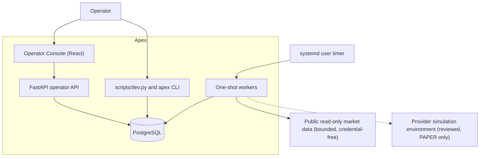
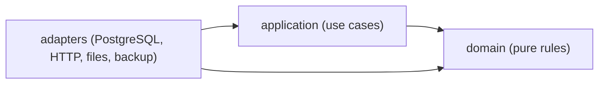
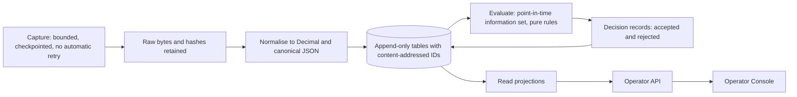
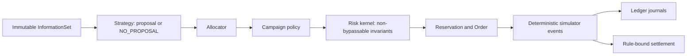
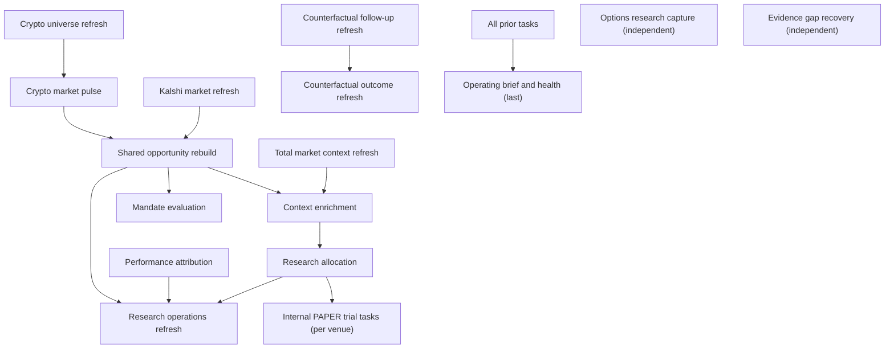
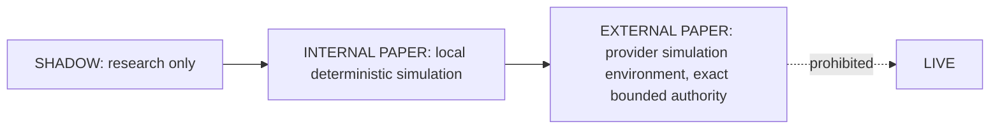

# Architecture Overview

Apex is organised as a strict three-layer core plus an operator surface. The
design goal is that the rules that decide anything financial are pure,
deterministic and testable without I/O, while everything that touches a
database, a network or a file is pushed to the edge.

## System context

The dashed edge is the only outbound path that can carry an order, and only
to a provider's own simulation environment; see
[SAFETY_MODEL.md](SAFETY_MODEL.md). No LIVE host appears in the code.

## Layers and the dependency rule

| Layer | Path | May import | Responsibility |
|---|---|---|---|
| Domain | `src/apex/domain` | standard library and other `apex.domain` modules | Value parsing, decision and risk rules, ledger, authority and readiness models, due-work planning, schema-compatibility classification. |
| Application | `src/apex/application` | domain (and standard library) | Use cases that sequence domain rules through repository and source interfaces. |
| Adapters | `src/apex/adapters` | application, domain, third-party I/O libraries | SQLAlchemy/psycopg repositories, bounded HTTP clients, fixture and file readers, the logical backup drill. |

Interfaces (`src/apex/cli.py`, `src/apex/operator_api.py`) wire adapters into
use cases.

**Enforcement.** `tests/security/test_architecture_boundaries.py` parses every
module with `ast` and fails if:

- a domain module imports an I/O-capable module, a non-domain `apex` module or
  any third-party package (`test_domain_imports_only_pure_standard_library_and_domain_modules`);
- an application module imports `apex.adapters`
  (`test_application_does_not_depend_on_adapters`);
- a migration imports mutable domain or application code
  (`test_migrations_never_import_mutable_domain_or_application_modules`);
- persistence packages are imported anywhere except designated PostgreSQL
  adapters (`test_only_postgres_adapter_imports_persistence_packages`);
- an HTTP-capable adapter imports beyond its exact, per-file allowed roots
  (the `*_IMPORT_ROOTS` constants in the same file), or dynamic loading and
  future-capability packages appear (`test_runtime_has_no_dynamic_loading_or_future_capability_packages`).

## Data flow

Key properties:

1. Every stored fact has an identity derived from its canonical content
   (`deterministic_id`, `content_digest` in `src/apex/domain/values.py`), so a
   replay produces the same row rather than a duplicate, and a changed input
   produces a different identity.
2. Rejections are first-class evidence. A rejected proposal, policy or risk
   decision is retained with its reasons (see the eight fixture outcomes and
   the counterfactual ledger in `src/apex/domain/counterfactual_ledger.py`).
3. Evaluation sees only records whose `available_at` is not later than the
   decision cutoff (see [ENGINEERING_DECISIONS.md](ENGINEERING_DECISIONS.md), ADR 6).
4. The ledger alone posts financial journals; reservations and releases are
   authorization state, not cash flow.

## The offline decision pipeline

The eight deterministic outcomes exercise this chain end to end:

A `NO_PROPOSAL`, policy rejection or invariant rejection is terminal and
creates no trade artifacts. Source: `src/apex/domain/decisions.py`,
`src/apex/domain/execution.py`, `src/apex/domain/ledger.py`.

## Recurring operating cycle (high level)

`TASK_ORDER` in `src/apex/domain/operating_cycle.py` fixes a deterministic
task order. A due-work planner decides, from retained state only, which tasks
are due; each task result is retained, and a failure blocks only its declared
dependents.

This is a simplified view (several tasks, such as options capture, portfolio snapshot and evidence gap recovery, declare no dependencies so their failure cannot block others); the exact dependency table lives in
`src/apex/domain/operating_cycle.py` and is covered by
`tests/test_operating_cycle.py` (for example the failure-propagation tests for
the market-pulse task). See [OPERATIONS_AND_RELIABILITY.md](OPERATIONS_AND_RELIABILITY.md).

## Authority model

Research autonomy and capital authority are separate systems. Domain records
carry `authority = "NONE"`; the only live gate (`ExecutionControlState`,
`src/apex/domain/live_readiness.py`) is never armed by any operational path.
See [SAFETY_MODEL.md](SAFETY_MODEL.md).

## Persistence design

- Reversible, linear Alembic chain (`migrations/versions/`), with a
  retained-evidence guard on destructive downgrades.
- Immutable tables: row-level triggers installed by `immutable_trigger_ddl`
  (`src/apex/adapters/postgres.py`).
- Mutable state (orders, reservations, positions) is updated under row locks
  in a fixed order (Campaign, Order, RiskReservation, Position) to avoid
  deadlock and double-spend; see the concurrency tests listed in
  [TESTING_AND_REPRODUCIBILITY.md](TESTING_AND_REPRODUCIBILITY.md).
