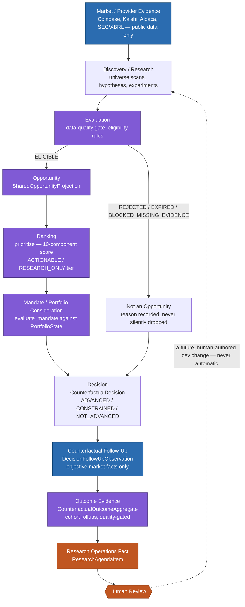

# System Mental Model

*Verified against migration head `0103`, primary `main` commit `f8eac3e` (2026-08-19); reconciled against migration head `0104`, primary `main` commit `052e956` (2026-08-22) — the flow and diagram below already name Alpaca as an evidence source and describe the pipeline venue-agnostically, so nothing here needed to change for the SECURITIES venue bridge. Reconciled again against migration head `0106`, primary `main` commit `c3f110f` (2026-09-01) — see "Strategy evaluation and PAPER execution" below, a new section closing a real gap: this document's flow and diagram describe the evidence/research/counterfactual loop in full but, until this pass, said nothing about the separate strategy-evaluation/PAPER-execution lifecycle that now runs alongside it. Reconciled again against migration head `0110` (2026-09-02) — the live catalog's own evaluation history is durable now; the same section below was updated in place. See docs/README.md for the full documentation index.*

This document gives the single high-level flow that everything else in Apex sits inside. If you read only one page of this documentation set, read this one.

**Scope note added 2026-09-01**: the flow and diagram immediately below cover the evidence → opportunity → decision → counterfactual → outcome loop specifically. A second, separately-governed lifecycle — strategy evaluation through PAPER execution — runs downstream of it; see [Strategy evaluation and PAPER execution](#strategy-evaluation-and-paper-execution) further down this same page.

## The flow



Every arrow in this diagram is a real, separately-implemented step — there is no single "Apex brain" object; each stage is pure, deterministic, and independently testable. The loop only closes through a **human** (node `K`): nothing in this pipeline automatically feeds outcome evidence back into `B` (discovery), `E` (ranking weights), or `F` (mandate rules). That would require a person to read the research-agenda item and author a code or policy change.

## Durable evidence vs. interpretation

This distinction matters and is easy to lose track of, so Apex's domain layer is built to keep it explicit:

**Durable evidence** — retained, content-hashed, immutable once written. Replaying the same evidence and policy always reproduces the identical ID.
- `ObservationCapture`, `ResearchDatasetSnapshot` — what a provider actually returned, when
- `DecisionFollowUpObservation` — an objective later fact about a market (a price, a status, a settlement)
- The raw `raw_reason_codes` on a `CounterfactualDecision` — each origin subsystem's exact original reason strings, preserved verbatim forever

**Interpretation** — derived, versioned, and explicitly re-derivable without touching the underlying evidence.
- `EligibilityState` / `PriorityTier` — a policy's read of the evidence at rank time
- `ReasonFamily` classification — a *separate*, versioned normalization layer over `raw_reason_codes` (two frozen versions exist, V1 and V2; a decision's classification can be recomputed under a new version without ever mutating the decision itself)
- `MandateEvaluation` — a pure function of one mandate version + one portfolio snapshot + one opportunity; a different mandate version yields a different, equally valid evaluation of the *same* underlying evidence

Put simply: evidence answers "what did we observe;" interpretation answers "what did we conclude from it, under which policy version." Apex is designed so interpretation can be revisited and re-run without ever losing or rewriting the evidence it was computed from.

## Walking the stages

1. **Market / provider evidence** — bounded, public, unauthenticated-by-default reads from Coinbase, Kalshi, Alpaca, and SEC/XBRL sources. Nothing here ever authenticates for a dangerous permission by accident (`PermissionClass` gates that separately).
2. **Discovery / research** — universe scans, cross-sectional discovery scoring, hypothesis/experiment pipelines, candidate generation (both the opportunity-candidate sense and, separately, bounded ML hyperparameter search for Strategy Lab — these are two distinct meanings of "candidate" in this codebase; see [Opportunity Lifecycle](OPPORTUNITY_LIFECYCLE.md)).
3. **Evaluation** — a genuine-data-quality gate (`USABLE` / `USABLE_WITH_WARNINGS` / `INSUFFICIENT` / `REJECTED`) and eligibility rules run before anything is treated as a candidate opportunity.
4. **Opportunity** — a `SharedOpportunityProjection` that cleared eligibility. Rejected/expired/missing-evidence candidates are *not* discarded — their reason is retained and explained (see node `Z`).
5. **Ranking** — only `ELIGIBLE` opportunities are scored; `ACTIONABLE` vs. `RESEARCH_ONLY` is an explanatory tier, never a filter.
6. **Mandate / portfolio consideration** — an `InvestmentMandate` evaluates the opportunity against current portfolio state; fails closed on any unknown fact.
7. **Decision** — every eligibility or mandate outcome, regardless of direction, becomes one immutable `CounterfactualDecision`.
8. **Counterfactual follow-up** — objective future facts get attached later, at defined horizons, gated by a fail-closed evidence-quality check before they're usable for anything downstream.
9. **Outcome evidence** — cohort-level aggregates, never a per-decision verdict.
10. **Future evidence weighting** — becomes a `ResearchAgendaItem`; a human decides whether and how to act on it.

See [Opportunity Lifecycle](OPPORTUNITY_LIFECYCLE.md) for stages 3–5 in depth, [Evidence and Feedback Lifecycle](EVIDENCE_AND_FEEDBACK_LIFECYCLE.md) for stages 7–10, and [Authority and Safety Model](AUTHORITY_AND_SAFETY_MODEL.md) for why none of this ever implies capital authority on its own.

## Strategy evaluation and PAPER execution

*New section, 2026-09-01.* The flow above ends at a human research-agenda decision — it does not execute anything. A separate, further lifecycle exists downstream, evidence-gated the same way as everything above it, and it is the one place in Apex today that has produced a real, non-zero simulated position:

```
StrategyDefinition --> lifecycle qualification (RESEARCH_ONLY / PAPER_ELIGIBLE)
                    --> PAPER eligibility this cycle
                    --> trial N: authorization --> intent --> preview --> submit
                    --> fill --> position --> reconciliation
                    --> realized / unrealized PAPER P&L
                    --> bounded evidence horizon reached
                    --> closing SELL (same authorize/intent/preview/submit path)
                    --> terminal trial N, cooldown
                    --> requalify --> trial N+1 (deterministic, distinct identity)
```

A few things worth being precise about:

- **This is PAPER, not live.** Every row this pipeline produces is `authority = "PAPER_ONLY"` (ledger/account level) or `"NONE"` (domain-decision level) — see [Authority and Safety Model](AUTHORITY_AND_SAFETY_MODEL.md). Nothing here reaches a real brokerage or exchange.
- **Two materially distinct paths feed it.** An older cross-venue path authorizes a PAPER trial from a cross-venue-allocation line over the Shared Opportunity set (stage 6 above); a newer, separate path (`STRATEGY_PAPER_TRIAL_EXECUTION`) authorizes one directly from a strategy's own evidence-gated promotion against retained market history, independent of the counterfactual-decision flow above. Both write into the same underlying ledger implementation, different accounts. See PAPER Operations & Observability v1 for the full, current distinction — do not assume they are the same subsystem just because both say "PAPER."
- **The live catalog's own evaluation now has a durable history, too.** Until Strategy Evaluation History & Promotion Lineage v1 (2026-09-02), the `STRATEGY_PAPER_TRIAL_EXECUTION` catalog's own `StrategyDefinition`/`StrategyLifecycleState` had no Postgres table at all — every cycle re-evaluated the fixed four-candidate benchmark catalog from scratch and threw the result away. Migration `0110` now durably retains every cycle's real evaluation result (`internal_strategy_evaluation`) and lets an operator explicitly, separately promote a candidate (`internal_strategy_promotion`) — without changing what the recurring cycle actually trades. **The live per-cycle trading decision is still a fresh in-memory gate check, unchanged by this** — a candidate can be genuinely traded this cycle while its durable, operator-facing lifecycle state honestly stays `RESEARCH_ONLY` until someone explicitly promotes it; the two are deliberately different questions. See Strategy Evaluation History & Promotion Lineage v1.
- **A separate, durable path also exists for operator-registered strategies.** External Strategy Evaluation v1 (2026-09-02) added durable persistence for `StrategyDefinition`/evaluation history (migration `0109`) — but only for strategies an operator explicitly registers through it, entirely independent of the live catalog above: it is never read by `STRATEGY_PAPER_TRIAL_EXECUTION`, and reaching `PAPER_ELIGIBLE` through it never authorizes a PAPER trial. See External Strategy Evaluation v1. These are two physically separate table pairs answering two different "which strategy" questions — see the new doc above for why they were kept apart rather than merged.
- **A qualifying strategy can trade the same instrument more than once, through bounded, repeatable trials.** Until Repeatable Strategy PAPER Evidence v1 (2026-09-03, migration `0111`), a strategy/instrument slot could produce at most one PAPER trial for its entire lifetime — elapsed time alone could never grow the evidence base. That milestone added an explicit, durably retained trial-generation model: at most one ACTIVE trial per slot at a time, a bounded PAPER-evidence horizon (deliberately distinct from the strategy's own canonical horizon — BUY_AND_HOLD's signal itself is still indefinite), closure through the same generic SELL machinery the ledger already supported but had never actually exercised, a cooldown before the next generation may begin, and re-evaluated qualification before it does. Repeated trials are operationally separated, never claimed statistically independent. See Repeatable Strategy PAPER Evidence v1.
- **`as_of`-bounded, never "latest."** Any point-in-time market lookup this pipeline needs (e.g. a position's unrealized mark) is bounded by the caller's own request-time `as_of` (`captured_at <= as_of`, deterministically tie-broken) — never an unbounded "most recent observation" query. This is a deliberate, load-bearing rule: an earlier version of the live-observation lookup didn't enforce it, produced a genuine race between the operating cycle's frozen `as_of` and the independently-scheduled live-observer worker, and was fixed in `b1554f7`. Any new code that reads live/intraday market state should follow the same rule.
- **A task can look broken while it is actually healthy.** Because of how intraday continuation works (see [Product Overview](PRODUCT_OVERVIEW.md#the-autonomous-operating-loop)), this pipeline's own task-health field can stay frozen on an old failure for days while it trades every cycle. Check the account's own reconciliation freshness, not just the task status — see PAPER Operations & Observability v1 for the exact fields.

Full field-by-field reference, state definitions, and worked examples: PAPER Operations & Observability v1. Day-to-day operator checks: Operator Guide. For why a strategy is in its current lifecycle state and what evaluation justified it, see Strategy Evaluation History & Promotion Lineage v1. For a strategy described OUTSIDE Apex (a paper, a blog, a manually typed hypothesis) rather than one of Apex's own methods, see External Strategy Evaluation v1 instead — a separate, bounded ingestion/evaluation path that reuses this exact same evidence discipline without ever touching the PAPER pipeline above.
